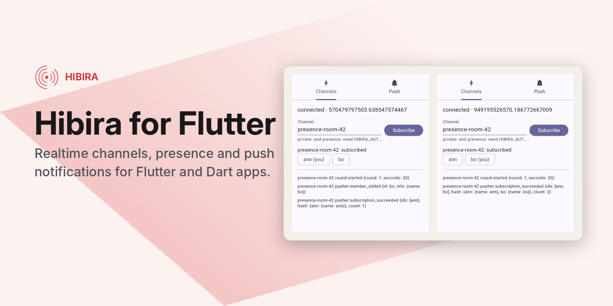

# Hibira for Flutter



Flutter and Dart packages for [Hibira](https://hibira.io), the realtime
WebSocket and push service that speaks the Pusher protocols.

| Package | What it does | Platforms |
|---|---|---|
| [`hibira`](packages/hibira) | Channels: public, private, presence and encrypted channels, client events, user sign-in. Pure Dart. | Android, iOS, web, desktop, Dart VM |
| [`hibira_push`](packages/hibira_push) | Push notifications through Hibira Push (Beams-compatible), wrapping the native SDKs. | Android, iOS |

```dart
import 'package:hibira/hibira.dart';

final hibira = HibiraClient('YOUR_APP_KEY');
await hibira.connect();
hibira.subscribe('orders').bind('shipped', (e) => print(e.data));
```

```dart
import 'package:hibira_push/hibira_push.dart';

await HibiraPush.instance.start('YOUR_INSTANCE_ID');
await HibiraPush.instance.requestPermission();
await HibiraPush.instance.addDeviceInterest('hello');
```

The [example app](example) shows both:

```sh
cd example
flutter run --dart-define=HIBIRA_APP_KEY=your-app-key \
  --dart-define=HIBIRA_PUSH_INSTANCE_ID=your-instance-id
```

Add `--dart-define=HIBIRA_AUTH_ENDPOINT=https://...` for private and
presence channels. Push on Android also needs your `google-services.json` in
`example/android/app`.

## Development

This is a [pub workspace](https://dart.dev/tools/pub/workspaces).

```sh
flutter pub get
(cd packages/hibira && dart test)
(cd packages/hibira_push && flutter test)
```

## Releasing

Both packages are published on pub.dev by the verified publisher
[hibira.io](https://pub.dev/publishers/hibira.io). To release, bump `version`
in the package's `pubspec.yaml`, add a `CHANGELOG.md` entry, merge, and push a
tag; GitHub Actions publishes it:

```sh
git tag hibira-v0.1.1 && git push origin hibira-v0.1.1            # packages/hibira
git tag hibira_push-v0.1.1 && git push origin hibira_push-v0.1.1  # packages/hibira_push
```

## License

MIT. See [LICENSE](LICENSE).
